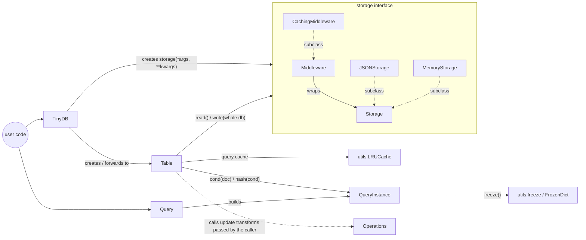

# TinyDB — Architecture

TinyDB is a small, pure-Python, document-oriented database. The whole database is one
nested `dict` (`{table_name: {doc_id: document}}`) that a pluggable *storage* persists
somewhere (a JSON file, memory, ...). The package has **no runtime dependencies**
(`pyproject.toml` declares no `dependencies`); only the standard library is used.

## 1. Overview

| Component | Module | Responsibility |
|---|---|---|
| **TinyDB** (database) | `tinydb/database.py` | Entry point. Instantiates the storage from `TinyDB(*args, storage=..., **kwargs)`, owns a `dict` of open `Table` objects, and forwards unknown attributes to the default table `_default` (so `db.insert(...)` == `db.table('_default').insert(...)`). |
| **Table / Document** | `tinydb/table.py` | All document operations (insert, search, get, update, upsert, remove, truncate). Reads/writes the *entire* database through the storage, assigns document IDs, and keeps a per-table query cache. `Document` is a `dict` that also carries `doc_id`. |
| **Query / QueryInstance** | `tinydb/queries.py` | Query language. `Query()` is a builder that records a field path; its operators return `QueryInstance` objects (callables `doc -> bool`) that can be combined with `&`, `|`, `~`. Each instance carries a hashable `hashval` describing what it tests. |
| **Storage** | `tinydb/storages.py` | Persistence layer. Abstract base `Storage` (`read()`, `write(data)`, `close()`), with `JSONStorage` (file) and `MemoryStorage` (in-memory). |
| **Middleware** | `tinydb/middlewares.py` | Wrappers around a storage that add behaviour without changing it. `Middleware` base class and `CachingMiddleware` (buffers writes in memory, flushes every `WRITE_CACHE_SIZE` writes and on `flush()`/`close()`). |
| **Operations** | `tinydb/operations.py` | Ready-made update transforms (`delete`, `add`, `subtract`, `set`, `increment`, `decrement`) that *callers* pass to `Table.update`; `Table` itself does not import this module. |
| **Utilities** | `tinydb/utils.py` | `LRUCache` (query cache), `FrozenDict`/`freeze()` (turn query arguments into hashable values), `with_typehint` (typing helper for `TinyDB`). |

**Who calls whom.** `TinyDB` creates the storage and the tables and hands the *same* storage
object to every table. `Table` calls only the storage interface (`read`/`write`) and its
`LRUCache`; it treats conditions through the `QueryLike` protocol (callable + hashable) and
never imports the concrete `Query` class. `QueryInstance` uses `utils.freeze` to build hash
values. A middleware is indistinguishable from a storage for `TinyDB` and `Table`: it is
passed as `storage=` and internally holds and calls the real storage.

**Data flow of a write.** `db.insert(doc)` → `TinyDB.__getattr__` → default `Table.insert` →
`Table._update_table(updater)`: read the whole database from the storage, convert the table's
document-ID keys to `document_id_class`, run `updater`, convert IDs back to `str`, write the
whole database back, then clear the table's query cache.

**Data flow of a search.** `Table.search(cond)` looks up `cond` in the query cache (the key is the
query object, compared by its `hashval`). On a miss it evaluates `cond` on every raw document,
wraps matches as `Document`, and stores a copy of the result list if the query is cacheable.

## 2. Architecture Decision Records

### ADR-1 — Storages persist the whole database as one dict

- **Status:** Verified — `Table._update_table` docstring (`tinydb/table.py:808-812`: "The storage
  interface used by TinyDB only allows to read/write the complete database data, but not modifying
  only portions of it"), and the abstract `Storage.read/write` signatures (`tinydb/storages.py:48-68`).
- **Context:** TinyDB targets small databases and wants new back-ends to be trivial to write.
- **Decision:** The storage interface has exactly two operations on the *complete* state:
  `read() -> dict | None` and `write(dict)`. An empty store returns `None` from `read()`.
  Tables implement partial updates as read-modify-write of the whole state (`_update_table`).
  Document-ID keys are written as strings because JSON objects only allow string keys; `Table`
  converts them back to `document_id_class` on read.
- **Alternatives considered:** a record-level API (get/put/delete per document or per table);
  storage-side indexing. Both make storages much harder to implement.
- **Consequences:** A new storage only has to serialize/deserialize one `dict`, so storages are
  tiny and interchangeable. Every write costs O(size of database); performance is recovered by
  wrapping storages in `CachingMiddleware`. Storages must not assume anything about the shape of
  the dict beyond "JSON-compatible".

### ADR-2 — Middlewares wrap storage *classes* and are configured through `storage=`

- **Status:** Verified — `Middleware.__call__` docstring (`tinydb/middlewares.py:25-63`) and the
  class docstring "Your middleware's `__init__` method has to call the parent class constructor so the
  middleware chain can be configured properly" (`tinydb/middlewares.py:17-18`).
- **Context:** Cross-cutting behaviour (caching, logging, ...) should be reusable with any storage
  without subclassing each storage.
- **Decision:** A middleware is constructed with the storage *class*:
  `TinyDB(path, storage=CachingMiddleware(JSONStorage))`. `TinyDB` calls `storage(*args, **kwargs)`;
  for a middleware this is `Middleware.__call__`, which instantiates the wrapped class with the same
  arguments, stores it as `self.storage` and returns the middleware itself. Middlewares can be
  nested, and unknown attributes are forwarded to the wrapped storage (`__getattr__`).
- **Alternatives considered:** subclassing storages (`CachingJSONStorage`, ...), which multiplies
  classes; passing storage *instances* to `TinyDB`, which would make the argument forwarding of
  `TinyDB(*args, **kwargs)` impossible.
- **Consequences:** Storages and middlewares compose freely, and any storage that follows the
  `Storage` interface works with every middleware. All constructor arguments a storage needs must
  be passable through `TinyDB(*args, **kwargs)`. Middlewares must implement `read`/`write`
  (and `close` if they hold state) and must call `super().__init__(storage_cls)`.

### ADR-3 — Per-table LRU query cache keyed by the query's hash value

- **Status:** Verified — `Table` class docstring, "Query Cache" (`tinydb/table.py:40-50`),
  `QueryInstance` docstring (`tinydb/queries.py:59-73`), and commit `e83efcd`
  "fix: include regex flags in matches/search query hash (#640)", which fixed a cache collision
  caused by an incomplete hash.
- **Context:** Searches are full scans over the whole table, and applications often repeat the same
  search.
- **Decision:** Each `Table` has an `LRUCache` (default capacity 10, `cache_size=0` disables it)
  mapping query → result list. Query objects are the cache keys, so every cacheable query must have
  a stable `hashval` that identifies *what it tests*: operator, field path and (frozen) operands.
  Combined queries derive their `hashval` from their operands' hash values plus the combinator.
  Queries whose result cannot be trusted to be stable (e.g. `Query.map` with an arbitrary callable)
  set `hashval = None`, which makes them non-cacheable. Any write through `_update_table` discards
  the whole cache.
- **Alternatives considered:** no cache (simpler, slower repeated searches); invalidating only the
  affected entries (complex and error-prone); caching by `id(query)` (would miss equal queries).
- **Consequences:** Two different queries that end up with equal `hashval`s silently return each
  other's cached results — correctness depends on hash values being complete. Searches return a
  copy of the cached list but the same document objects. Writes that bypass `_update_table` leave
  stale results in the cache.

## 3. Constraints

| # | Rule (do not break when changing the code) | Where it can be seen |
|---|---|---|
| C1 | **New storages subclass `Storage`** and implement `read()` (returning `None` for an empty store) and `write(data)` on the whole database dict; release resources in `close()`. | `tinydb/storages.py:36-75` (`Storage` ABC), `JSONStorage.read` returns `None` at `tinydb/storages.py:134` |
| C2 | **All mutations of table data go through `Table._update_table`**, never `storage.write` from `Table` methods directly; it is where ID conversion and query-cache invalidation happen. | `tinydb/table.py:804-854` (`self._storage.write(tables)` at :851, `self.clear_cache()` at :854) |
| C3 | **Every cacheable query has a complete, hashable `hashval`** (operator + path + operands passed through `freeze()`); queries that cannot guarantee a stable result must use `hashval=None`. | `tinydb/queries.py:218-252` (`_generate_test`), `tinydb/queries.py:527` (`map` kills the hash), `tinydb/utils.py:150` (`freeze`) |
| C4 | **Layering:** `table.py` depends on the `QueryLike` protocol, not on `Query`; `queries.py` and `storages.py` must not import `table.py` or `database.py`; middlewares only depend on `Storage`. | imports at `tinydb/table.py:15-17`, `tinydb/queries.py:23`, `tinydb/storages.py:5-11`, `tinydb/middlewares.py:7` |
| C5 | **Storages and middlewares are configured through `TinyDB(*args, storage=X, **kwargs)`**: `TinyDB` passes all its other arguments to `X`, so storage options must be constructor arguments, and middlewares must call `super().__init__(storage_cls)`. | `tinydb/database.py:92-95`, `tinydb/middlewares.py:17-23, 63` |
